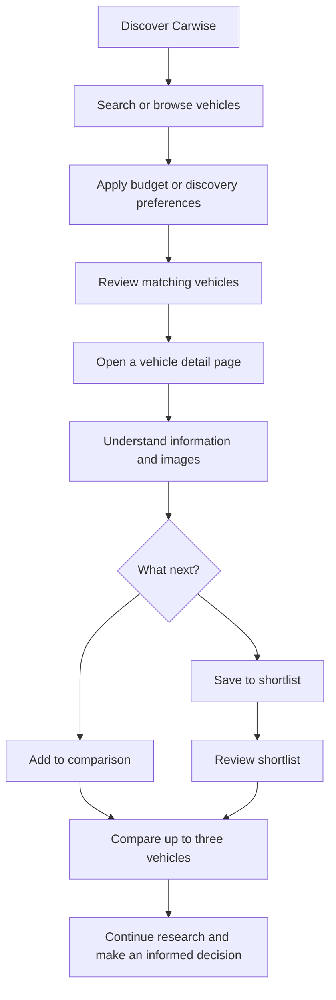
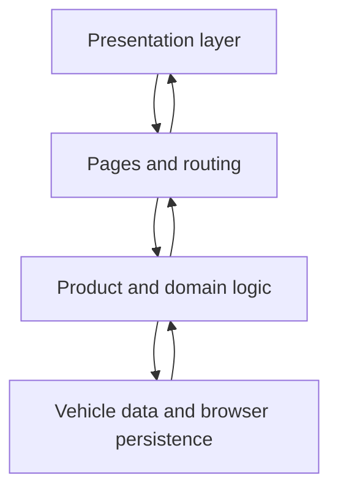
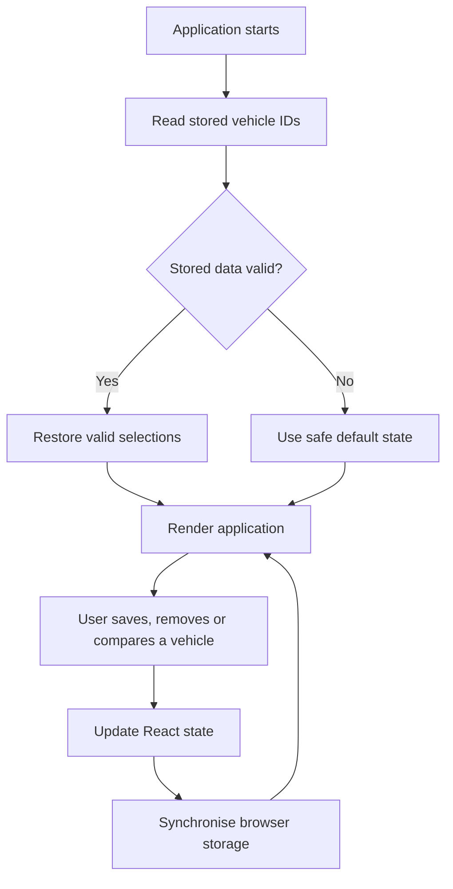

# Carwise — Project Learning Manual

> **Live application:** https://carwise-umber.vercel.app  
> **Project type:** Frontend-first automotive discovery and research MVP  
> **Primary market:** India  
> **Status:** Deployed to production

This manual records the product thinking, decisions, implementation journey, frontend concepts, testing work, limitations, and future direction behind Carwise. It is written for someone opening the repository for the first time and for the person who built and maintains it.

## Contents

1. [Project overview](#1-project-overview)
2. [Problem and product opportunity](#2-problem-and-product-opportunity)
3. [Users and their needs](#3-users-and-their-needs)
4. [Product principles](#4-product-principles)
5. [MVP scope and deferred work](#5-mvp-scope-and-deferred-work)
6. [The eight major features implemented](#6-the-eight-major-features-implemented)
7. [Core user journeys](#7-core-user-journeys)
8. [Application structure and technical approach](#8-application-structure-and-technical-approach)
9. [Frontend concepts used](#9-frontend-concepts-used)
10. [State and browser persistence](#10-state-and-browser-persistence)
11. [Responsive design and accessibility](#11-responsive-design-and-accessibility)
12. [Edge cases and expected behaviour](#12-edge-cases-and-expected-behaviour)
13. [Testing, quality checks and deployment](#13-testing-quality-checks-and-deployment)
14. [Data credibility and limitations](#14-data-credibility-and-limitations)
15. [Development phases](#15-development-phases)
16. [Lessons learned](#16-lessons-learned)
17. [Future improvements](#17-future-improvements)
18. [Glossary](#18-glossary)

---

## 1. Project overview

### 1.1 What is Carwise?

Carwise is a car discovery and research experience designed to help people understand which vehicle may suit their needs. It brings discovery, vehicle information, guided matching, shortlisting, and comparison into one coherent frontend experience.

**Product line:** Find the car that fits your life.

The aim is not simply to display a catalogue of cars. The product helps a buyer move from an initial need or idea towards a more informed shortlist.

### 1.2 Project summary

| Item | Description |
|---|---|
| Product | Carwise |
| Category | Automotive discovery and research |
| Primary market | India |
| Platform | Responsive web application |
| Primary audience | People researching their next car |
| Product approach | Frontend-first MVP |
| Data approach | Curated local vehicle data |
| Main experience | Search, discover, understand, shortlist and compare |
| Deployment | Vercel |
| Live URL | https://carwise-umber.vercel.app |

### 1.3 Product vision

Help people understand cars well enough to choose a car that fits their needs—not simply the most popular or impressive one.

### 1.4 Problem statement

Buying a car involves balancing several factors: budget, daily usage, passenger space, fuel economy, maintenance, safety, comfort, and personal preferences.

A buyer may need to move between specification tables, professional reviews, owner opinions, and comparison pages to understand which car actually suits them. A car can look impressive on paper and still be the wrong fit for someone's daily life.

**Carwise's product goal:** help people discover suitable vehicles, understand the trade-offs between them, and evaluate options through a manageable shortlist and comparison experience.

---

## 2. Problem and product opportunity

Carwise connects three activities that are often treated as separate tasks:

1. **Discover:** narrow down available vehicles using budget and preferences.
2. **Understand:** review vehicle information and make sense of important details.
3. **Decide:** save alternatives and compare them in a manageable way.

### The signature experience: “What fits me?”

A buyer deciding between several cars should be able to understand which options fit their budget, which may suit city commutes or family use, where each car offers an advantage or compromise, and which specifications deserve closer attention.

The interface should make trade-offs visible without suggesting that one vehicle is universally best.

---

## 3. Users and their needs

### Primary: first-time buyer
- Has a budget and a rough idea of what they need.
- May not understand which specifications matter.
- Needs clear explanations and manageable choices.
- Benefits from a straightforward discovery journey.

### Secondary: practical and family buyers
- Care about comfort, space, safety, budget, and running costs.
- Need to weigh practical trade-offs.
- May compare several body styles or vehicle sizes.

### Secondary: automotive enthusiasts and informed researchers
- Already know some models.
- Want detailed information and comparisons.
- Benefit from being able to shortlist and evaluate alternatives.

**Design priority:** make the first-time buyer's journey understandable while allowing more informed users to move quickly through search, details, and comparison.

---

## 4. Product principles

1. **Clarity over information overload.** Present useful explanations and summaries rather than overwhelming people with information.
2. **Evidence over assumptions.** Distinguish factual specifications, editorial assessments, and illustrative sample content.
3. **Buyer priorities over generic rankings.** Help people evaluate vehicles according to their own needs.
4. **Visuals with a purpose.** Use vehicle imagery to support understanding, not merely decoration.
5. **A consistent, responsive experience.** Important functionality should remain usable on desktop, tablet, and mobile.
6. **Keep the buyer in control.** Let people choose what to save and compare.
7. **Explain trade-offs.** A recommendation should not pretend that one option is perfect for everyone.

---

## 5. MVP scope and deferred work

The MVP focused on completing the core discovery-to-decision journey.

### Included in the MVP
- Homepage and primary navigation.
- Vehicle search and budget filtering.
- Vehicle browsing and discovery.
- Individual vehicle detail pages.
- Vehicle information and gallery interactions.
- Guided car discovery.
- Shortlisting and removal.
- Comparison with a maximum of three selected cars.
- Browser persistence for shortlist and comparison selections.
- Empty and no-results states.
- Responsive layouts.
- Accessibility improvements and keyboard interaction support.
- Production build, lint checks, and deployment.

### Deliberately deferred
- User accounts and authentication.
- Cloud-synchronised shortlists.
- A backend or database-backed vehicle catalogue.
- Verified user review submissions and moderation.
- Admin dashboard.
- Live prices, dealer offers, and test-drive booking.
- Advanced ownership-cost estimates.
- Variant-level comparison.
- Mechanical 3D vehicle exploration.
- AI recommendations or chatbot functionality.

**Why defer them?** A complete, well-tested frontend MVP is more valuable than a partially implemented full-stack product. The first version should prove that the core journey works before adding infrastructure and complexity.

---

## 6. The eight major features implemented

The following is the feature count tracked during the Carwise build. These are the **eight major product features**, not a count of every small UI refinement or engineering task.

### Feature 1 — Car search and budget filtering

**Goal:** let users find relevant vehicles instead of manually browsing every listing.

**Implemented work:**
- Added search logic for vehicle names and relevant listing information.
- Added budget filtering.
- Displayed matching vehicle results.
- Added a clear no-results state when nothing matches.

**Concepts involved:** React state for search and budget, filtering an array of vehicle records, derived results, and conditional rendering.

### Feature 2 — Car shortlist functionality

**Goal:** let users mark vehicles they may want to consider later.

**Implemented work:**
- Added save and unsave interactions.
- Used React state to track selected vehicles.
- Added a live shortlist count in the navigation.
- Updated the visual state of the save control.

**Concepts involved:** state updates, adding and removing array items, synchronising counts, and accessible interaction states.

### Feature 3 — Dedicated shortlist view

**Goal:** give saved vehicles a dedicated place where users can review them.

**Implemented work:**
- Created a shortlist view.
- Displayed saved vehicle cards.
- Added removal controls.
- Added an empty state for users who have not saved anything yet.

**Concepts involved:** rendering collections, reusing vehicle-card UI, and conditional rendering for populated and empty states.

### Feature 4 — Shortlist persistence

**Goal:** prevent saved vehicles from disappearing after a page refresh.

**Implemented work:**
- Stored shortlist selections in `localStorage`.
- Restored saved selections when the application loads.
- Added safer storage-reading and storage-writing helpers during cleanup.
- Handled invalid stored JSON more safely.

**Concepts involved:** browser storage, JSON serialisation/parsing, lazy state initialisation, `useEffect`, and defensive handling of malformed or unavailable values.

**Important:** `localStorage` is browser-local persistence. It is not a user account or cloud database and does not synchronise selections between devices.

### Feature 5 — Car comparison

**Goal:** help users evaluate a small number of vehicles side by side.

**Implemented work:**
- Added comparison selection.
- Limited comparison to a maximum of three cars.
- Allowed users to remove selected vehicles.
- Persisted comparison selections across refreshes.
- Added comparison count feedback.
- Added feedback when the selection limit is reached.
- Improved the comparison control's accessible state.

**Concepts involved:** selected collections in React state, duplicate prevention, maximum selection limits, persistence, and interaction feedback.

**Product decision:** a maximum of three vehicles keeps comparison manageable rather than allowing an unwieldy selection.

### Feature 6 — Discovery experience polishing

**Goal:** make the browsing and discovery experience more coherent and easier to use.

Discovery and browsing refinements were grouped under this feature in the original progress tracking. The wider polish work included clearer interaction states, result feedback, and consistency across the discovery journey.

**Note:** this is the original feature-count label. It represents a group of discovery improvements rather than one isolated component. It should not be confused with the separately tracked guided-discovery questionnaire in Feature 8.

### Feature 7 — Individual vehicle detail pages

**Goal:** allow users to move from a listing to a page dedicated to one vehicle.

**Implemented work:**
- Added individual vehicle detail pages.
- Used vehicle identifiers in the URL to find the corresponding record.
- Added vehicle-specific information and overview content.
- Added a vehicle image gallery.
- Added an image lightbox interaction.
- Connected detail-page actions to shortlist and comparison behaviour.
- Added a graceful not-found state for an unavailable vehicle.

**Concepts involved:** React Router and route parameters, record lookup by identifier, reusable data, conditional rendering, refs, and accessible lightbox behaviour.

### Feature 8 — Guided Car Discovery

**Goal:** help users narrow down vehicles using their needs and preferences.

**Implemented work:**
- Added a guided discovery experience.
- Collected user preferences through a sequence of inputs.
- Evaluated the available vehicle dataset against the selected criteria.
- Displayed relevant matching vehicles.
- Allowed users to continue to vehicle details and shortlist actions.

**Concepts involved:** controlled form inputs, React state, deterministic filtering/matching logic, derived results, and explaining trade-offs.

**Important:** this is a rules-based frontend discovery experience. It is not a machine-learning model or an AI recommendation engine.

### Feature summary

| # | Feature | Main outcome |
|---:|---|---|
| 1 | Car search and budget filtering | Find matching vehicles |
| 2 | Shortlist functionality | Save and unsave vehicles |
| 3 | Dedicated shortlist view | Review and remove saved vehicles |
| 4 | Shortlist persistence | Retain selections after refresh |
| 5 | Car comparison | Compare up to three vehicles |
| 6 | Discovery experience polishing | Improve browsing clarity and consistency |
| 7 | Individual vehicle detail pages | Inspect one vehicle in depth |
| 8 | Guided Car Discovery | Match the catalogue to buyer preferences |

**Total: 8 major product features.**

### Engineering and quality work beyond the eight features

These were additional implementation and completion tasks, not extra numbered product features:
- Safe `localStorage` parsing and writing.
- Comparison-limit feedback and accessible pressed states.
- Lightbox Escape-key handling, focus management, and focus restoration.
- Global `:focus-visible` styling and form-control focus styling.
- Removal of obsolete CSS selectors.
- Consolidation of duplicate vehicle-detail CSS rules.
- Reduced-motion support.
- Responsive layout review.
- Accessibility review.
- Functional QA across the main user journeys.
- Production build and lint checks.
- Deployment to Vercel.

---

## 7. Core user journeys

The main journey is:



### Workflow A — Browse and search

1. User opens the homepage.
2. User searches for a vehicle or opens the car-browsing experience.
3. The application displays available vehicles.
4. User applies search or budget criteria.
5. The displayed results update.
6. If no vehicles match, the application explains this and provides a useful empty state.
7. User opens a vehicle detail page.

### Workflow B — Evaluate a vehicle

1. User opens a vehicle detail page.
2. The application loads the available information and images for that vehicle.
3. User reviews the overview and available specifications.
4. User explores the available gallery views.
5. User uses the available detail-page actions.
6. User saves the vehicle or adds it to comparison.
7. The application updates the relevant state and provides feedback.

### Workflow C — Guided discovery

1. User opens Find Your Fit.
2. User selects a budget and available preferences.
3. The application evaluates the local vehicle dataset against those criteria.
4. The application displays matching vehicles.
5. User adjusts preferences or opens a vehicle's details.
6. User shortlists suitable vehicles for later comparison.

### Workflow D — Compare vehicles

1. User selects Compare from a vehicle card or detail page.
2. The application adds the vehicle if it is not already selected and the limit has not been reached.
3. User opens the comparison experience.
4. The application displays selected vehicles and their available information.
5. User removes a selection or returns to research.
6. The comparison selection remains available after refresh where persisted.

### Workflow E — Manage shortlist

1. User saves a vehicle.
2. The application stores the selected vehicle identifier in browser storage.
3. User opens the shortlist view.
4. User opens a vehicle, removes it, or starts comparing.
5. On refresh, valid saved selections are restored.
6. If no vehicles are saved, a helpful empty state is shown.

---

## 8. Application structure and technical approach

### 8.1 Technology used

| Technology | Role |
|---|---|
| React | Component-based user interface |
| TypeScript | Typed JavaScript and safer data structures |
| Vite | Development server and production build tooling |
| React Router | Client-side navigation and route parameters |
| CSS | Application styling, layout, responsive rules and visual states |
| `localStorage` | Browser-local persistence |
| Git and GitHub | Version control and repository hosting |
| Vercel | Production deployment |

**Implementation accuracy note:** the initial planning material considered Tailwind CSS, but the delivered application styling was maintained in CSS files such as `App.css` and `index.css`. This manual describes the implemented approach rather than treating every early proposal as a shipped dependency.

### 8.2 Main application layers

The application can be understood as four cooperating layers:

1. **Presentation:** reusable UI such as navigation, vehicle cards, buttons, specification areas, and empty states.
2. **Pages and routing:** homepage, discovery, and individual vehicle detail experiences.
3. **Domain logic:** search, filtering, shortlist operations, comparison limits, and guided matching.
4. **Data and persistence:** local vehicle data, URL parameters, React state, and browser storage.



This separation helps prevent every page from having to independently implement the same filtering, saving, or comparison rules.

### 8.3 Routing

The implemented application includes the main homepage, discovery experience, and individual vehicle detail URLs.

| Route pattern | Purpose |
|---|---|
| `/` | Homepage |
| `/discover` | Guided discovery |
| `/cars/:carId` | Individual vehicle detail page |

The `:carId` segment is a route parameter. It identifies which vehicle record should be displayed.

The original product blueprint also considered dedicated `/cars`, `/compare`, and `/shortlist` routes. Treat those as proposed information architecture unless the current source code confirms that a dedicated route exists. The actual UI behaviour and current route configuration are the source of truth.

### 8.4 Vehicle data

The application uses a local curated vehicle dataset. Vehicle records provide information used by cards, search, discovery, and detail pages.

A conceptual vehicle record may contain a stable identifier, make and model, category or body type, price information, descriptive information, image path, and available detail information. Check the current data file in the repository for the exact fields and values before changing the model.

---

## 9. Frontend concepts used

### Components
A React component is a reusable unit of interface. A vehicle card can be reused in multiple places instead of writing a separate card implementation for every page.

### Props
Props pass information from a parent component to a child component. A vehicle card can receive the vehicle information it needs to display.

### State
State stores information that can change while the user interacts with the application. Examples include the search query, selected budget, saved vehicles, comparison selections, guided-discovery answers, and lightbox visibility.

### Derived data
Filtered vehicles should generally be calculated from the original dataset and current search/filter state. This avoids maintaining a second, manually synchronised copy of the same results.

```ts
const filteredCars = cars.filter((car) => {
  // Check the active search and filter conditions.
  return true;
});
```

This is an explanatory example, not a replacement for the project's actual filtering implementation.

### Event handlers
Event handlers respond to actions such as clicking Save, selecting a budget, or removing a comparison item. A handler updates the relevant state and React renders the new state.

### Effects
`useEffect` synchronises React with external systems. In Carwise, an important example is synchronising selected vehicle IDs with browser storage.

### Refs
A React ref provides access to a DOM element or mutable value without causing a render by itself. Refs were used in the lightbox accessibility work to manage focus.

### Conditional rendering
Conditional rendering shows the appropriate interface for the current state—for example, a populated shortlist versus an empty shortlist, or a valid vehicle page versus a not-found state.

### React Router
React Router maps URLs to application views. Route parameters make it possible to use one detail-page component for different vehicle records.

### TypeScript
TypeScript adds types to JavaScript. Types describe the shape of vehicle records and help catch mistakes while developing.

---

## 10. State and browser persistence

### React state versus browser storage

- **React state** keeps the current UI responsive while the application is running.
- **`localStorage`** retains selected information in the same browser across reloads.

The shortlist and comparison experience use React state for interaction and browser storage for persistence.

### Conceptual persistence flow



### Why safe parsing matters

Browser storage contains strings. Data is commonly serialised with `JSON.stringify` and restored with `JSON.parse`.

Stored data may be missing, malformed, or no longer match the current vehicle dataset. Storage access can also fail in some browser environments. Defensive helpers reduce the chance that these conditions break the application.

**Limitation:** browser storage is not a secure database, user account, or cloud-sync mechanism. Clearing browser data can remove saved selections. Another browser or device will not automatically have the same shortlist.

---

## 11. Responsive design and accessibility

### Responsive design

Carwise was reviewed across desktop, tablet, and mobile layouts. Responsive design is not simply shrinking the desktop page; the layout must continue to support the same important tasks at narrower widths.

Areas reviewed included navigation, vehicle cards and grids, detail-page layout, comparison and discovery experiences, spacing and overflow, and controls.

### Accessibility improvements

The cleanup and QA work included:
- Visible keyboard focus styles using `:focus-visible`.
- Focus styling for search inputs and select controls.
- Accessible labels and pressed states for interactive controls.
- Status feedback for comparison-limit messages.
- Escape-key support for closing the image lightbox.
- Focus management and focus restoration for the lightbox.
- Reduced-motion support.

Accessibility improves the experience for keyboard users, people using assistive technology, and people interacting with the application in different environments. It is part of functional quality, not a decorative finishing step.

---

## 12. Edge cases and expected behaviour

| Situation | Expected behaviour |
|---|---|
| Search returns no vehicles | Explain that no results match and show a useful recovery action |
| Budget and search filters return no matches | Keep controls usable and show the empty state |
| User tries to add a duplicate comparison item | Avoid duplicate selection |
| User tries to add a fourth comparison vehicle | Enforce the three-vehicle limit and provide feedback |
| Shortlist is empty | Show an empty state and a way back to discovery |
| A saved vehicle is removed | Update the shortlist and its count |
| Stored browser data is invalid | Fall back safely rather than crashing |
| A vehicle ID does not resolve | Show a graceful not-found state |
| User refreshes after saving | Restore valid saved selections |
| Image lightbox is open | Support Escape to close and sensible focus behaviour |
| User prefers reduced motion | Avoid unnecessary animation and motion |

The table describes intended handling and areas addressed during implementation and QA. If behaviour changes later, update both the code and this documentation.

---

## 13. Testing, quality checks and deployment

### Functional QA

The project went through focused functional checks for the main user journeys, including homepage interactions, search and discovery, shortlist interactions, comparison and the three-car limit, persistence after refresh, vehicle detail navigation, guided discovery, responsive layouts, and keyboard/accessibility behaviour.

### Build and lint

The following commands were run successfully after the final CSS cleanup:

```bash
npm run build
npm run lint
```

- `npm run build` checks the TypeScript production build and creates the Vite production bundle.
- `npm run lint` runs ESLint checks against the project.

A successful build and lint run are useful quality checks, but they do not replace testing the application in a browser.

### Deployment

Carwise was deployed to Vercel. The production deployment was opened and the live application was checked after deployment.

**Production URL:** https://carwise-umber.vercel.app

### Suggested checks after future changes

1. Run the development server.
2. Test the changed interaction in the browser.
3. Check the relevant responsive layout.
4. Run `npm run build`.
5. Run `npm run lint`.
6. Review the production deployment after it updates.

---

## 14. Data credibility and limitations

Carwise concerns a high-consideration purchase. Data accuracy and honest presentation matter.

- Do not imply that sample prices are live prices.
- Do not invent verified owner reviews or manufacturer claims.
- Do not imply a safety rating applies to every variant or model year.
- Distinguish ex-showroom prices from on-road prices where relevant.
- Distinguish claimed mileage from real-world owner-reported mileage.
- Show unavailable information as unavailable rather than inventing a value.
- Record sources and dates when adding researched specifications.
- Label illustrative sample reviews clearly; do not present them as verified owner testimonials.

### Current MVP limitations

The current product is a frontend-first prototype using local data and browser persistence. It does not provide live vehicle inventory or price feeds, authenticated user accounts, cross-device synchronisation, a review-submission and moderation system, a production backend or database, or verified continuously updated ownership data.

These are limitations of the current scope, not features that should be implied to exist.

---

## 15. Development phases

The original implementation plan was organised as a short, focused build.

### Day 1 — Foundation and UI migration

**Goal:** get Carwise running in React.

Planned work:
- Create the React + TypeScript project with Vite.
- Configure the styling setup.
- Extract colours, typography, spacing, and radii from the reference design.
- Split the interface into reusable React components.
- Move the initial vehicle records into typed data.
- Recreate the main discovery screen and responsive navigation.
- Add setup and architecture documentation.

### Day 2 — Functionality and polish

**Goal:** make the main user journey work.

Planned work:
- Implement search, filters, sorting, and clear-all behaviour.
- Implement shortlist and comparison, including the three-car limit.
- Make empty-result feedback consistent.
- Persist shortlist and comparison selections.
- Refine cards, active states, focus states, and contrast.
- Fix mobile overflow and review responsive layouts.
- Check important interactions and edge cases.

### Day 3 — Completion and deployment

**Goal:** have a credible, presentable MVP.

Planned work:
- Complete vehicle detail and comparison experiences required by the user journey.
- Finish the budget/use-case discovery flow.
- Review content, prices, specifications, and image usage.
- Run the production build and fix errors.
- Test keyboard navigation, loading/empty states, and mobile usability.
- Deploy the application and document the live link.
- Record implementation decisions and prepare the project case study.

The three-day plan was the initial execution plan. The project subsequently continued through additional feature work, accessibility improvements, cleanup, QA, and deployment.

---

## 16. Lessons learned

### Build the journey, not isolated screens
A homepage alone does not make a useful product. The experience becomes meaningful when users can search, inspect a vehicle, save it, and compare it with alternatives.

### State needs a clear source of truth
Keeping selected vehicle IDs in state and deriving displayed records from the dataset avoids unnecessary duplication.

### Persistence introduces real edge cases
Saving data is not just writing to `localStorage`. The application also needs to restore it safely, handle malformed values, and tolerate records that are no longer available.

### Accessibility is part of interaction design
Keyboard focus, Escape-key behaviour, focus restoration, and status messages are important parts of a working interface.

### Responsive behaviour must be checked, not assumed
A layout that looks good on desktop can become cramped or difficult to use on mobile. Responsive checks need to include real interactions.

### A frontend MVP can be a complete portfolio project
A carefully scoped frontend with coherent product logic, useful states, responsive behaviour, and clear limitations can demonstrate meaningful product and engineering ability without an unnecessary backend.

### Understand the code being shipped
Generated or copied code should be reviewed and understood before integration. The developer should be able to explain the important components, state, event handlers, and decisions—not merely recognise code that looks familiar.

---

## 17. Future improvements

Future work should be prioritised only after the current MVP remains stable.

### Version 2 — More depth
- More sophisticated guided recommendations.
- Ownership-cost estimates with clearly stated assumptions.
- Variant-level comparison.
- Richer review filtering and sorting.
- More detailed vehicle information.
- A polished theme toggle, if it adds real value.

### Version 3 — Backend capabilities
- Real user accounts.
- Cloud-saved shortlists.
- A database-backed vehicle catalogue.
- Verified review submissions and moderation.
- An admin interface.
- Reliable external data integrations.

### Longer-term product direction

A mechanical vehicle explorer could help interested buyers understand components such as the engine, drivetrain, suspension, and chassis. This is a future direction, not a capability of the current MVP.

**Prioritisation rule:** do not build the backend or advanced features simply because they are technically possible. Add them when a clear user or product requirement justifies them.

---

## 18. Glossary

| Term | Meaning |
|---|---|
| React | JavaScript library for building component-based user interfaces |
| Component | Reusable piece of UI |
| Props | Data passed from a parent component to a child |
| State | Data that can change and trigger a UI update |
| Hook | React function used to access features such as state, effects, or refs |
| `useState` | React hook for component state |
| `useEffect` | React hook for synchronising with external systems |
| `useRef` | React hook for retaining a mutable reference, often to a DOM element |
| TypeScript | JavaScript with a static type system |
| Vite | Frontend development server and build tool |
| React Router | Library for client-side routing |
| Route parameter | Dynamic part of a URL, such as `:carId` |
| `localStorage` | Browser storage that persists key-value data across reloads |
| JSON | Text format commonly used to serialise structured data |
| Derived data | A value calculated from existing data and state |
| Responsive design | Layout and interaction adaptation across screen sizes |
| Accessibility | Designing so people with different abilities and input methods can use the product |
| Edge case | Less common situation that still needs predictable behaviour |
| MVP | Minimum viable product: the smallest coherent version that delivers the core value |
| Deployment | Publishing an application so people can access it online |

---

## Final project note

Carwise began as a product concept for helping people research their next car. It became a deployed, interactive frontend MVP with eight tracked product features, responsive layouts, persistent shortlist and comparison state, individual vehicle detail pages, and guided discovery.

The most important outcome is not simply that the application is online. It is that the project demonstrates a connected product journey: **discover, find a fit, evaluate, and decide.**

**Live project:** https://carwise-umber.vercel.app
